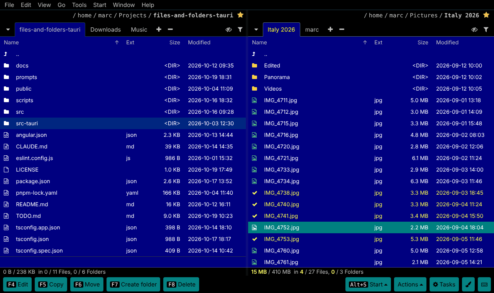
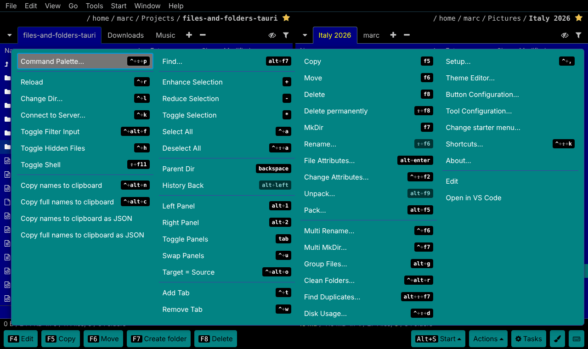
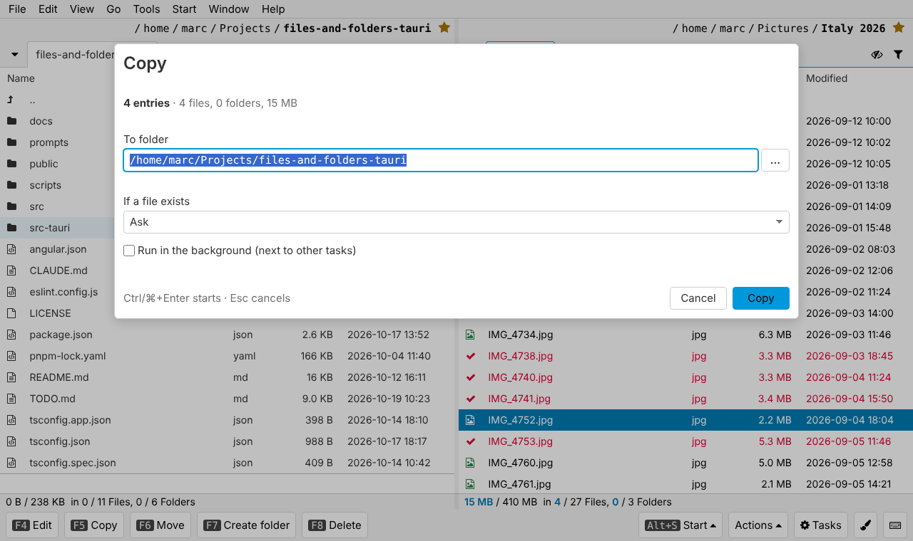
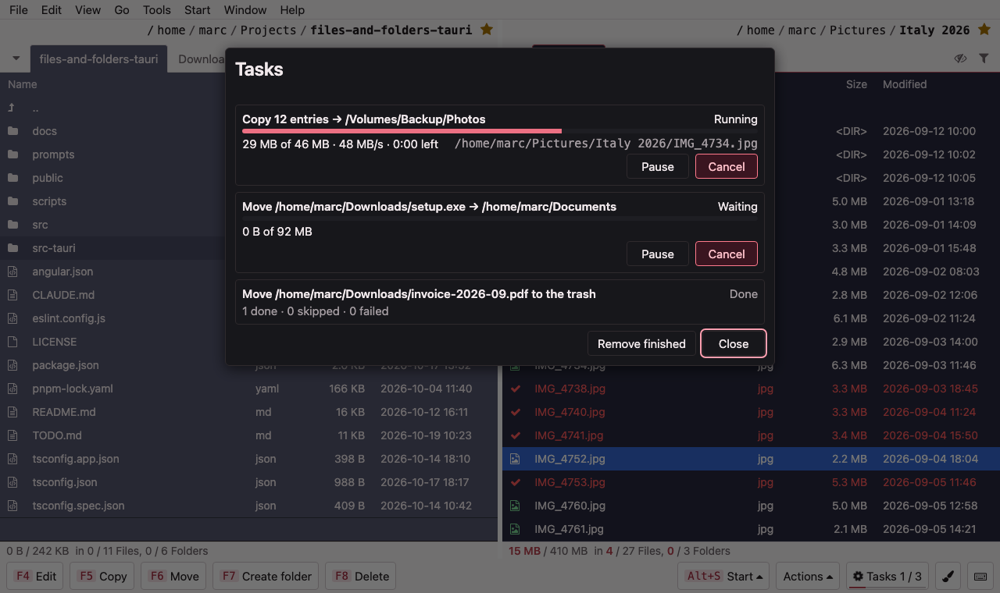
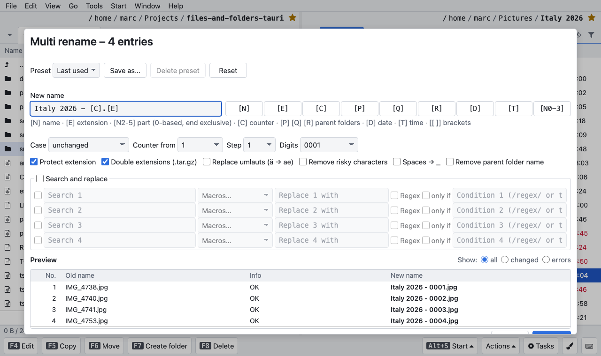
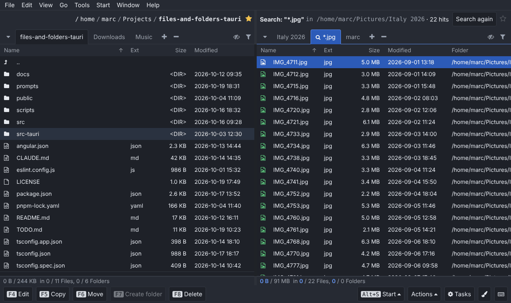
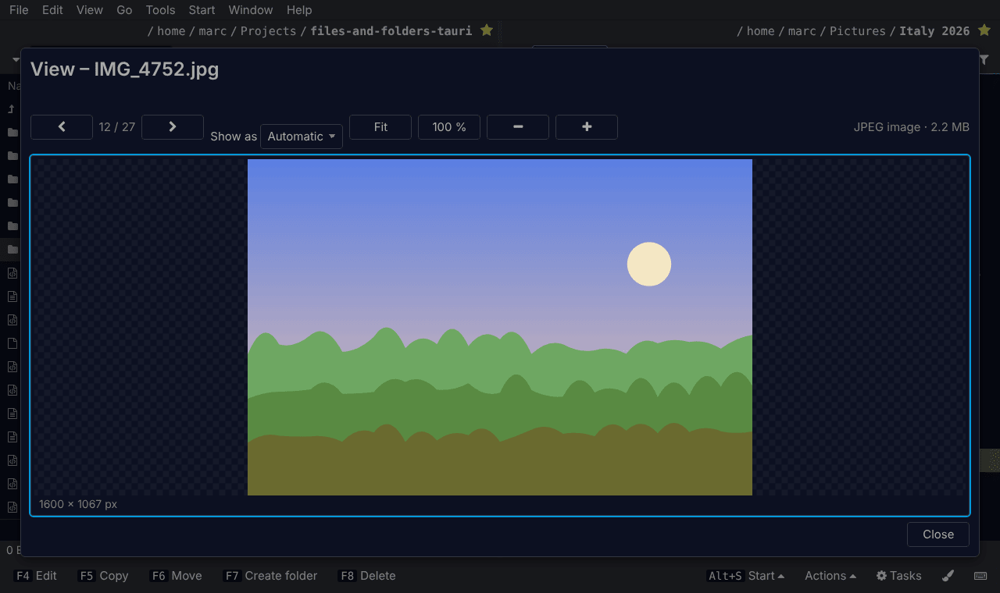
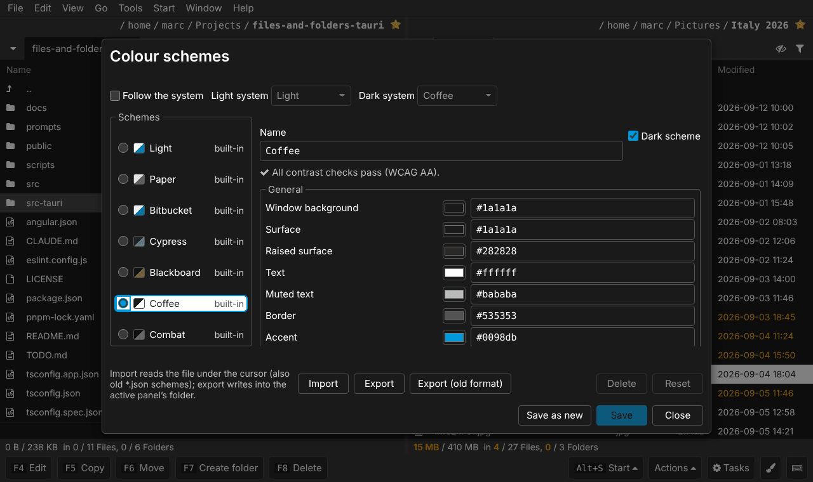
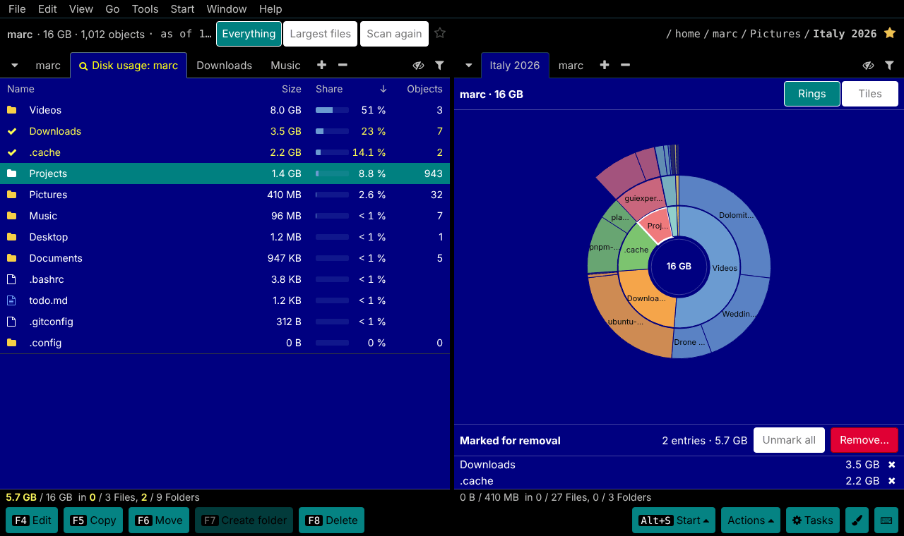
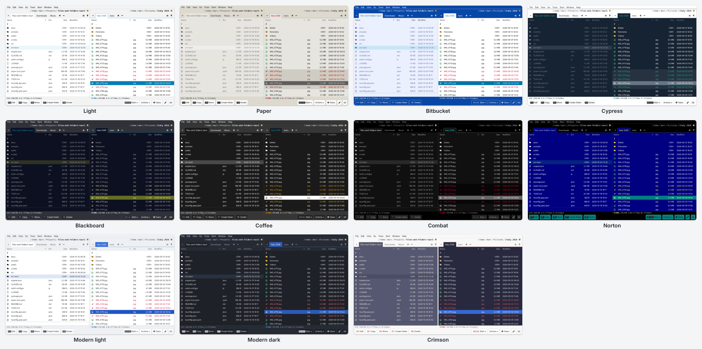

<p align="center">
  
</p>

<h1 align="center">Files and Folders</h1>

<p align="center">
  A fast, keyboard-driven, two-panel file manager for <b>macOS</b>, <b>Windows</b> and <b>Linux</b> –
  in the spirit of Total Commander and Norton Commander.
</p>

<p align="center">
  
  
  
  
  
  
</p>

---

> [!WARNING]
> **This app is under active development.** There is no public release yet, things change daily and some
> features are still missing or only lightly tested (especially on Windows and macOS). Use it on data you have
> backed up – and feedback is very welcome!

**Files and Folders** (FnF) is the desktop successor of the browser-based
[`files-and-folders`](https://www.npmjs.com/package/files-and-folders) (Node.js + AngularJS, 2016) and of
[files-and-folders-mr](https://github.com/krocon/files-and-folders-mr) (Angular + NestJS, 2025). It is rebuilt
from scratch as a native desktop app with **[Tauri 2](https://tauri.app)**, **Angular 22** and a **Rust** backend –
no local web server, no browser tab, just one small app.

The file list is a [GuiExpert Table](https://github.com/guiexperttable/mono): virtual scrolling, 100 000 entries
without stutter.



<p align="center"><i>The classic <b>Norton</b> colour scheme – one of eleven built-in designs.</i></p>

## Main features

- **Cross-platform** – one app for macOS, Windows and Linux, with native menus on macOS and keymaps per OS
- **Orthodox two-panel layout** – source and target side by side, path breadcrumbs, favourites, status line,
  button bar that changes with `Shift` / `Alt` / `Ctrl` (`⌘`)
- **Tabs** on both sides – clone, drag to reorder or onto the other side (`Ctrl`/`⌥` copies), each tab keeps path,
  sort order, column widths and cursor
- **Panel actions** like Total Commander – swap the panels (`Ctrl+U` / `⌘U`, with all tabs `Ctrl+Shift+U`),
  *target = source* (`Ctrl+Alt+O` / `⌘⌥O`), open the folder under the cursor in the left/right panel
  (`Ctrl+←/→` / `⌘⌥←/→`)
- **Session restore** – tabs, active side, splitter, favourites and window position survive a restart; each tab
  also remembers cursor, marks and scroll position of its last 50 folders
- **Keyboard first** – every function is an action with an id; shortcuts are configurable, a command palette
  (*Command Palette*) finds every action
- **Background jobs** – copy, move, delete, pack and search run as jobs with progress, rate, remaining time,
  pause, resume and cancel; conflicts are asked once or “for all”
- **Safe by default** – delete goes to the **trash**, no half-written files under the real name, rename never
  overwrites, dangerous targets (root, home, system folders) need a second confirmation
- **Multi rename** with live preview, macros, counters, case rules, regex replacements, presets and **undo**
- **Group files** into folders by name, **clean folders** (empty folders, `*.bak`, `.DS_Store` …),
  **create many folders** from a template
- **Search** with glob/regex, content, size, date, depth and presets – results stream into a **result tab** you
  can work with like a normal folder
- **Archives** – open ZIP / TAR / TAR.GZ / 7z / RAR like a folder, view (F3) and open (Enter) files inside,
  pack (ZIP, 7z, TAR, TAR.GZ) and unpack, with passwords (ZIP AES/ZipCrypto, 7z, RAR; kept in memory only)
  – zip-slip and zip-bomb safe
- **Server connections** (`Ctrl+K` / `⌘K`) – FTP, FTPS and SFTP servers as folders in the panels: browse with
  tabs and history, copy and move in both directions as jobs, delete, create, rename, view (`F3`) and open files.
  Passwords and key passphrases are kept **only in the system keychain** (macOS Keychain, Windows Credential
  Manager, Secret Service) – never in a file of the app; SSH host keys and FTPS certificates are checked, plain FTP
  is marked as unencrypted
- **Flat view** (`Ctrl+B` / `⌘B`) like Total Commander – every file below the folder in one list with a *Path*
  column, in the same tab; mark, copy, move, delete, rename and multi-rename across all subfolders, back with the
  same key
- **Find duplicates** by content (SHA-256) or size, with “keep newest / oldest / first” helpers
- **Compare files** – two files side by side with line numbers and coloured differences (ignore white space or
  case, whole file or only the changes, `F7` jumps to the next one), binaries byte by byte; or hand them to
  FileMerge, WinMerge or Meld
- **Checksums** – create SHA-256/SHA-512/SHA-1/MD5 lists (`sha256sum`-compatible) or one file per file, verify a
  checksum file with a list of changed and missing files, copy the SHA-256 of a file to the clipboard
- **Viewer** (`F3`) for text, hex and images, **quick view** in the other panel, **properties**
- **Change attributes** – permissions (octal or per bit), Windows attributes, macOS *hidden*, modification /
  access / creation time; for many entries at once (only what you touch changes) and optionally for folder contents
- **Auto refresh** – folders shown in both panels are watched; changes by other programs appear in under a second
- **Disk usage** (`Ctrl+Shift+D` / `⌘⇧D`, or *Disk usage of the drive…*) – scans the marked folders, the folder
  under the cursor or the whole drive: a list by size with share bars next to rings or tiles in the other panel,
  Enter goes into a folder, *Largest files* lists the big ones of the subtree, marks collect across all folders and
  `F8` removes them (trash; anything changed since the scan is left alone)
- **Drag & drop** between panels, from Finder / Explorer / your file manager, and out of the window into other
  programs (copy); with `Ctrl+Shift` (`⌘⌥`) it creates **symbolic links** (also *Create link…*, `Ctrl+Shift+F5`)
- **External tools** and *Open terminal here* / *Show in Finder/Explorer* – tools are started **without a
  shell**, configured in a small JSON file
- **Shell line** below the panels (`Shift+F11`): run a command in the current folder, output streamed, history
- **Colour schemes** – the eight classic designs (Light, Paper, Bitbucket, Cypress, Blackboard, Coffee, Combat,
  Norton) plus modern light/dark and Crimson, *follow the system*, a live editor with WCAG contrast check, import/export
- **Configurable button bar and file types** – structured editors for the buttons per modifier set and for the
  file type categories (icons, colours, *mark by type*); own search templates are kept
- **Full screen** with `F11` on Windows/Linux (`⌃⌘F` on macOS)
- **Settings dialog** with search, export/import of the whole configuration
- **Import from the previous version** – shortcuts, buttons, file types, search patterns, tools, colour schemes
  and two settings of *files-and-folders-mr*, with a preview per area and a backup of every changed file
- **English and German** UI, switchable at runtime



<p align="center"><i>The <b>Actions</b> menu (<code>Ctrl+F12</code>) lists every action with its shortcut.</i></p>

The complete feature list with all details (in German) is in **[docs/features.md](docs/features.md)**; the
comparison with the previous version is in [docs/feature-parity.md](docs/feature-parity.md).

## Screenshots

| | |
| --- | --- |
|  |  |
| **Copy** – target, conflict default, background (*Light*) | **Tasks** – progress, rate, pause and cancel (*Crimson*) |
|  |  |
| **Multi rename** – pattern, counter, preview (*Modern light*) | **Search** – results stream into a tab (*Modern dark*) |
|  |  |
| **Viewer** (`F3`) – text, hex and images (*Blackboard*) | **Colour schemes** – live editor, WCAG check (*Coffee*) |
|  | |
| **Disk usage** (`Ctrl+Shift+D`) – list by size, rings or tiles, remove what is big (*Norton*) | |

All eleven built-in colour schemes:



The pictures are generated: `pnpm screenshots:docs` refreshes them, `pnpm screenshots` captures every dialog in
every colour scheme ([docs/screenshots.md](docs/screenshots.md)).

## Status and roadmap

| Area | State |
| --- | --- |
| File list, panels, tabs, session | ✅ done |
| Copy / move / delete / rename / create, job engine | ✅ done |
| Multi rename, group files, clean folders, multi mkdir | ✅ done |
| Search, folder finder, duplicates, archives | ✅ done |
| Viewer, quick view, properties | ✅ done |
| Watcher, drag & drop (into the app), clipboard, external tools, shell line | ✅ done |
| Colour schemes, settings, menus, English/German | ✅ done |
| Slow and network drives (responsive UI, listing cache) | ✅ done |
| Drag from the app into other programs | ✅ done (copy only) |
| Drag tabs, symbolic links by drag or dialog | ✅ done |
| Further features from the previous version | 🚧 planned (see [feature-parity](docs/feature-parity.md)) |
| Signed packages, first public release, auto update | 🚧 prepared, not set up |

Details: [docs/roadmap.md](docs/roadmap.md).

## Supported platforms

| OS | Minimum | Package |
| --- | --- | --- |
| macOS | 12 Monterey (Apple Silicon and Intel) | `.dmg` (universal) |
| Windows | 10 / 11 (x64) | `-setup.exe` (no admin needed) or `.msi` |
| Linux | WebKitGTK 4.1 – Ubuntu 22.04+, Debian 12+, Fedora 36+ | `.deb`, `.rpm`, `.AppImage` |

## Installation

There is **no published release yet.** Until then, build the app yourself (see [Development](#development)).
Once releases are available they will appear on the
[GitHub releases page](https://github.com/krocon/files-and-folders-tauri/releases):

- **macOS:** open the DMG and drag *Files and Folders* to *Applications*.
- **Windows:** run the installer (WebView2 is installed if missing).
- **Linux:** `sudo apt install ./files-and-folders_<version>_amd64.deb`, `sudo dnf install ./….rpm`,
  or make the AppImage executable (`chmod +x`) and start it.

Early packages will be **unsigned**: on macOS right-click the app → *Open*; on Windows SmartScreen choose
*More info* → *Run anyway*.

## Keyboard shortcuts (selection)

All shortcuts can be changed in **Keyboard shortcuts…** (`Ctrl+Shift+K` / `⌘⇧K`); the command palette
(`Ctrl+Shift+P` / `⌘⇧P`) lists every action.

| Action | Windows / Linux | macOS |
| --- | --- | --- |
| View | `F3` | `F3` |
| Edit (tool `edit`) | `F4` | `F4` |
| Copy / Move | `F5` / `F6` | `F5` / `F6` |
| Create folder | `F7` | `F7` |
| Delete (trash) / delete permanently | `F8` / `Shift+F8` | `F8`, `⌘⌫` / `⌘⌥⌫` |
| Rename in list / dialog | `F2` / `Shift+F6` | `F2` / `⇧F6` |
| Multi rename | `Ctrl+M` | `⌘F6` |
| Find | `Alt+F7` | `⌥F7` |
| Find folder (change dir) | `Alt+F10` | `⌥F10` |
| Flat view (all files below) | `Ctrl+B` | `⌘B` |
| Mark / unmark | `Space`, `Insert` | `Space` |
| Switch panel | `Tab` | `Tab` |
| New tab / close tab | `Ctrl+T` / `Ctrl+W` | `⌘⌥T` / `⌘⌥W` |
| Swap panels (with all tabs) | `Ctrl+U` (`Ctrl+Shift+U`) | `⌘U` (`⌘⇧U`) |
| Target = source / open in other panel | `Ctrl+Alt+O` / `Ctrl+←`, `Ctrl+→` | `⌘⌥O` / `⌘⌥←`, `⌘⌥→` |
| Move tab left / right | `Ctrl+Shift+PgUp` / `Ctrl+Shift+PgDn` | `⌃⇧PgUp` / `⌃⇧PgDn` |
| Create link | `Ctrl+Shift+F5` | `⌘⇧F5` |
| Go to path | `Ctrl+L` | `⌘L` |
| Toggle hidden files | `Ctrl+H` | `⌘⇧.` |
| Quick view | `Ctrl+Q` | `⌃Q` |
| Pack / unpack | `Alt+F5` / `Alt+F9` | `⌥F5` / `⌥F9` |
| Properties / change attributes | `Alt+Enter` / `Ctrl+Shift+F2` | `⌘I` / `⌘⇧F2` |
| Open terminal here | `Ctrl+Shift+C` | `⌘⇧C` |
| Connect to server | `Ctrl+K`, `Ctrl+N` | `⌘K`, `⌘N` |
| Shell line | `Shift+F11` | `⇧F11` |
| Full screen | `F11` | `⌃⌘F` (menu *Window*) |
| Settings | `Ctrl+,` | `⌘,` |

The full table is in [docs/features.md](docs/features.md#tastenkürzel-stand-prompt-002).

## Customization

Everything is stored as JSON in the app's config folder and can be edited from within the app:

- **Colours** – *Colour schemes…* dialog with live preview; schemes can be exported as `<name>.theme.json` and
  imported again (the old `--fnf-*` format of the previous versions is understood as well).
- **Shortcuts** – per OS (`macos`, `windows`, `linux`), overrides in `keymap.json`. An action can have several
  shortcuts, chords like `⌃K F6` are possible.
- **External tools** – `tools.json`: `program` + `args` array with placeholders such as `{file}`, `{files}`,
  `{dir}`, `{targetDir}`; optional `shortcut`. Example:

  ```json
  { "id": "edit", "label": "Edit", "program": "code", "args": ["{files}"] }
  ```

- **Starter menu** – menu *Start*, the *Start ▴* button next to *Actions ▴* or `Alt+S`: your own quick launch entries (programs, scripts, folders,
  submenus), edited with *Change starter menu…* and kept in `starter.json`. Parameters as in Total Commander –
  `%P%N` file under the cursor, `%N` name, `%O`/`%E` name without/only the extension, `%P`/`%T` folder of the
  active/other side, `%S` all marked entries; every word is one argument, nothing runs through a shell. Each entry
  can have its own shortcut.
- **Buttons** – *Button configuration…* (menu *Tools*): per modifier set (none, `Shift`, `Ctrl`/`⌘`, `Alt`) the
  actions of the bottom bar; changed sets are kept in `buttons.json`.
- **File types** – *File types…*: categories with extensions, icon and colour; they drive the file icons and the
  presets of *Mark by pattern* (`filetypes.json`, the old `[{label, extensions}]` format is read as well).
- **Settings** – `settings.json` (sizes, date format, row height, trash, start folder, language, own search
  templates …); the whole configuration can be exported and imported as one file.
- **Coming from the previous version** – *Import from Files and Folders (old)…* (menu *Tools*, *Settings ▸
  Data*) reads the `assets` folder of *files-and-folders-mr* (the repository folder is enough), shows per area what
  would be imported, what conflicts and what cannot be transferred, and keeps a `.bak` of every file it changes.

## Development

Requirements: **Node.js** `^22.22.3` / `^24.15.0` / `>=26`, **pnpm** 10 (`corepack enable`), **Rust** stable ≥ 1.90
and the [Tauri prerequisites](https://v2.tauri.app/start/prerequisites/) for your OS
(macOS: Xcode command line tools; Windows: C++ build tools + WebView2; Linux: `libwebkit2gtk-4.1-dev` and friends).

```bash
git clone https://github.com/krocon/files-and-folders-tauri.git
cd files-and-folders-tauri
pnpm install
pnpm tauri dev        # Angular dev server (port 1420) + desktop window
```

| Task | Command |
| --- | --- |
| All checks (format, lint, tests, build, Rust) | `pnpm check` |
| Frontend tests (Vitest) | `pnpm test` |
| Rust tests / clippy | `pnpm rust:test` / `pnpm rust:lint` |
| Release build (packages per OS) | `pnpm tauri build` |
| Screenshots of every colour scheme × every dialog | `pnpm screenshots` ([docs/screenshots.md](docs/screenshots.md)) |

Architecture and rules: [docs/architecture.md](docs/architecture.md) and [CLAUDE.md](CLAUDE.md);
release process: [docs/release.md](docs/release.md).

### Tech stack

- **Tauri 2** – small native shell, narrow validated commands, strict CSP, no broad file-system or shell plugins
- **Rust** – listing, file operations, job engine, search, archives, watcher, platform code
- **Angular 22** – standalone components, signals, zoneless, plain CSS with design tokens
- **[GuiExpert Table](https://github.com/guiexperttable/mono)** – the file list and all preview grids
- **Font Awesome 4.5** – icons

## History

| Year | Project | Stack |
| --- | --- | --- |
| 2016 | [`files-and-folders`](https://www.npmjs.com/package/files-and-folders) | Node.js, Socket.IO, AngularJS – runs in the browser |
| 2025 | [files-and-folders-mr](https://github.com/krocon/files-and-folders-mr) | NestJS, Angular 20 – runs in the browser |
| 2026 | **files-and-folders-tauri** (this repo) | Tauri 2, Rust, Angular 22 – native desktop app |

## Contributing

Issues and ideas are welcome on [GitHub](https://github.com/krocon/files-and-folders-tauri/issues). Since the app
is still moving fast, please open an issue before starting a larger pull request.

## License

[MIT](LICENSE) © Marc Kronberg

Third-party licenses: [docs/licenses.md](docs/licenses.md).
