<p align="center">
  
</p>

<h1 align="center">Files and Folders (FnF)</h1>

<p align="center">
  <b>A fast, keyboard-first two-panel file manager for macOS, Windows and Linux –<br>
  in the spirit of Norton Commander and Total Commander.</b>
</p>

<p align="center">
  
  
  
</p>

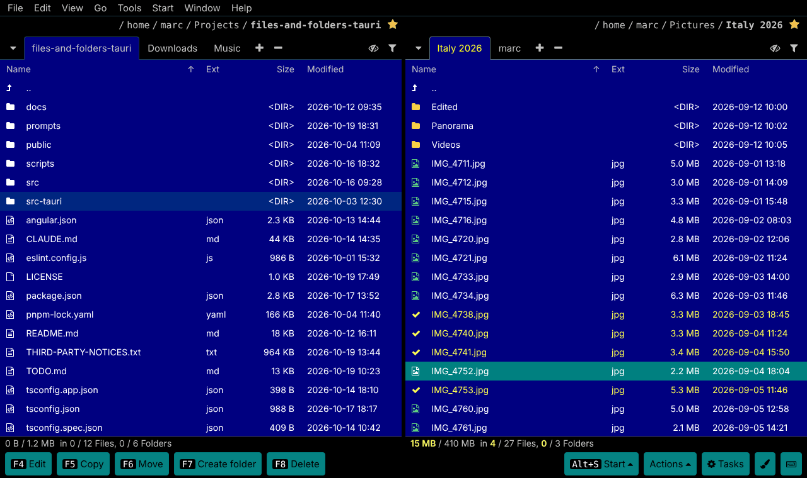

**Become a master of file management.** I have been building file managers for myself since 2016 – first one
that ran in the browser, now a real desktop app. FnF puts two folders side by side, lets you do everything with
the keyboard and runs the slow work in the background while you go on. Copy, move, rename hundreds of files at
once, find duplicates, look into archives and servers – without reaching for the mouse.

> [!NOTE]
> **There is no public release yet.** You can build the app from source today (see [Installation](#installation)).
> The automated tests run on Linux, macOS and Windows, but some platform specifics (the trash per drive on Windows,
> attributes, links) still need testing on real macOS and Windows machines. Back up what you care about – and tell
> me what breaks.

## Main features

1. [Two panels, tabs everywhere](#two-panels-tabs-everywhere)
2. [Keyboard first – every function is one keystroke away](#keyboard-first)
3. [Find anything from the Command Palette](#find-anything-from-the-command-palette)
4. [Jobs in the background](#jobs-in-the-background)
5. [Safe by default](#safe-by-default)
6. [Multi rename with preview and undo](#multi-rename-with-preview-and-undo)
7. [Search into a tab](#search-into-a-tab)
8. [Flat view](#flat-view)
9. [Duplicates and similar images](#duplicates-and-similar-images)
10. [Disk usage](#disk-usage)
11. [Archives as folders](#archives-as-folders)
12. [FTP, FTPS and SFTP servers](#ftp-ftps-and-sftp-servers)
13. [Viewer and quick view](#viewer-and-quick-view)
14. [Compare files](#compare-files)
15. [Group files and clean folders](#group-files-and-clean-folders)
16. [Shell line](#shell-line)
17. [Starter menu](#starter-menu)
18. [Colour schemes](#colour-schemes)
19. [And more](#and-more)

Shortcuts are written *Windows/Linux · macOS*. All of them can be changed.

## Two panels, tabs everywhere

**Source on the left, target on the right – the fastest way to move files around.**
Each side has a clickable path, favourites, a status line and as many tabs as you like. Drag tabs to reorder them
or onto the other side, swap the panels, or make the target show the same folder as the source. Tabs, cursor,
marks, sort order and column widths survive a restart; every tab even remembers its last 50 folders.

`Tab` switch side · `Ctrl+T` / `Ctrl+W` new / close tab · `Ctrl+U` swap panels · `Ctrl+Alt+O` target = source ·
macOS: `Tab` · `⌘⌥T` / `⌘⌥W` · `⌘U` · `⌘⌥O`

## Keyboard first

**Every function is an action with a name and a shortcut – type a few letters, press Enter.**
The *Command Palette* finds any action by name and shows its shortcut, so you learn the keys on the way. The
*Actions* menu lists all of them in groups. The classic keys are where you expect them: `F3` view, `F5` copy,
`F6` move, `F7` new folder, `F8` delete. The button bar at the bottom changes with `Shift`, `Alt` and `Ctrl`.

`Ctrl+Shift+P` palette · `Ctrl+F12` actions menu · `Ctrl+Shift+K` shortcuts ·
macOS: `⌘⇧P` · `⌃K ⌃M` · `⌘⇧K`

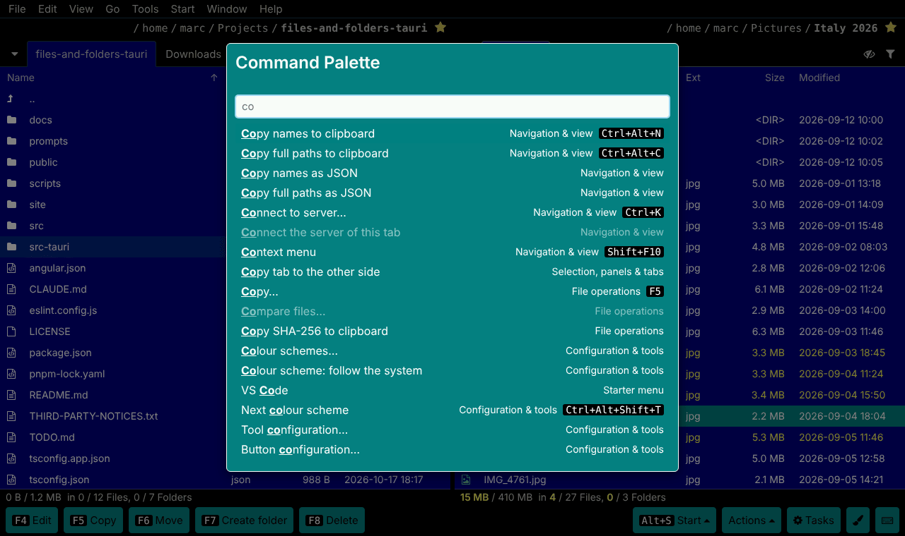

<details>
<summary>The <i>Actions</i> menu – every action in four columns</summary>

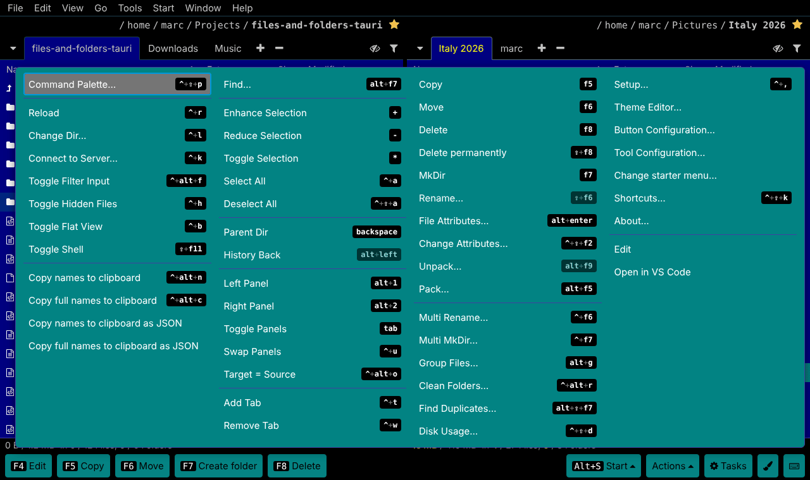

</details>

## Find anything from the Command Palette

**Type `invoice 2025` – files from all your folders, actions and folders in one list, and act on a hit at once.**
The palette searches a name index that is built in the background and kept up to date (only names, sizes and dates, only
in memory – about 50 MB per million files), plus your tabs, favourites and recent folders directly. Every word must
appear in the name or a folder above it; case and accents don't matter. Narrow it down with `ext:pdf`, `in:Projects`,
`size>10m`, `modified:2025` or `is:dir`; `>` lists only actions, `~/` completes a path. On a hit, the keys you know
work: `Enter` opens, `F3` shows a preview beside the list, `F5`/`F6` open the copy/move dialog with the other side as
target, `Shift+F6` renames; `Tab` shows everything else – go to its location, find similar files, analyse the parent
folder, show all hits in a result tab.

`Ctrl+Shift+P` palette · `Tab` actions on the hit · `Insert` mark several ·
macOS: `⌘⇧P` · `Tab` · `Insert`

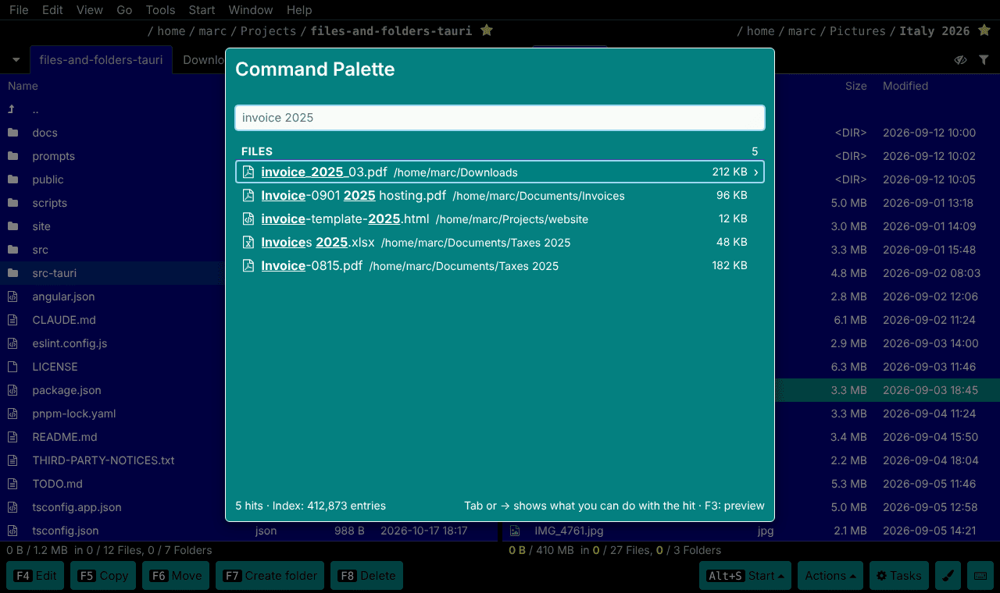

## Jobs in the background

**Start a big copy and keep working – the app never freezes.**
Copy, move, delete, pack and search run as jobs with progress, rate and remaining time. Pause them, resume them,
cancel them; several jobs line up in a queue. Slow network drives and servers are handled the same way – the
panels stay usable.

`F5` copy · `F6` move · `Ctrl+F11` tasks · macOS: `F5` · `F6` · `⌃K F6`

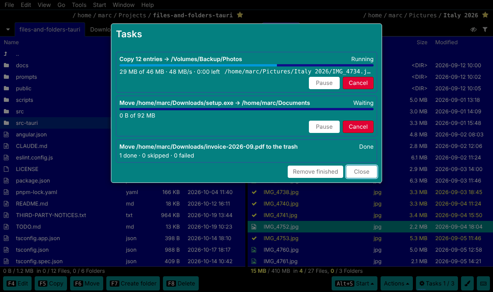

## Safe by default

**Delete goes to the trash, nothing is overwritten without asking.**
When a file already exists you see both versions with size and date and decide once – or for all further
conflicts: overwrite, skip, overwrite if newer, or rename. Copies are written under a temporary name first, so
there is never a half-written file under the real name. Renaming never overwrites, and dangerous targets (root,
home, system folders) need a second confirmation.

`F8` trash · `Shift+F8` delete permanently · macOS: `F8`, `⌘⌫` · `⇧F8`, `⌘⌥⌫`

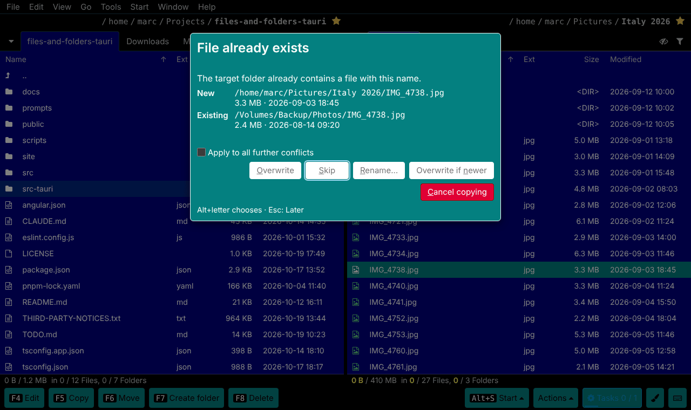

## Multi rename with preview and undo

**Rename hundreds of files in one go – and see every new name before you press the button.**
Build names from macros like `[N]` name, `[E]` extension, `[C]` counter, `[D]` date, use upper/lower case rules,
search and replace with regular expressions, replace umlauts and risky characters. Errors (duplicate names,
invalid characters) are shown in the preview. Save your patterns as presets – and if it was a mistake: undo.

`Ctrl+M` · macOS: `⌘F6`

![Multi rename: the pattern "Italy 2026 - [C].[E]" turns four photos into "Italy 2026 - 0001.jpg" and so on](docs/screenshots/readme/multi-rename.png)

## Search into a tab

**Search results land in a tab you work with like a folder.**
Search by name (glob or regex), content, size, date and depth; results stream in while the search runs. Copy,
move, delete, rename or view the hits directly, jump to the folder of a hit, run the search again. Keep your
favourite searches as templates.

`Alt+F7` find · `Ctrl+Shift+F7` search again · `Alt+F10` find folder · macOS: `⌥F7` · `⌘⇧F7` · `⌥F10`

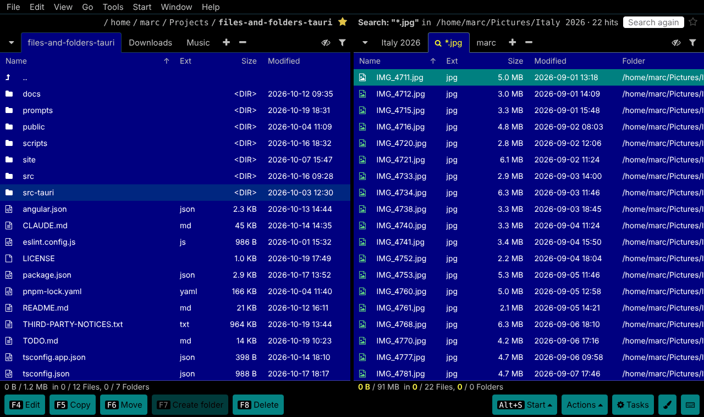

## Flat view

**Every file below a folder in one list.**
Like Total Commander's flat view: all files of all subfolders in the same tab, with a *Path* column. Sort them,
mark them, copy or delete them, rename them – across all subfolders at once. The same key brings the normal view
back.

`Ctrl+B` · macOS: `⌘B`

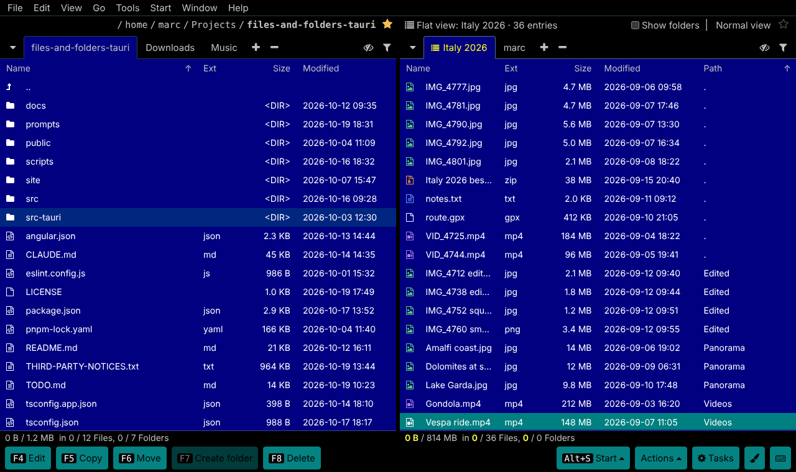

## Duplicates and similar images

**Free space without fear: rules decide which copy stays.**
Find files with the same content (SHA-256, optionally byte by byte), **similar images** (another size, quality or
format) or similar comics. Rules like *keep the oldest*, *the shortest path*, *the higher resolution* or *not the
one named "copy"* mark the rest; hard links are recognised as the same file. Check each group with thumbnails, then
delete to the trash, permanently or into a folder – every copy is compared again right before.

`Alt+Shift+F7` · `Alt+↓` / `Alt+↑` next / previous group · macOS: `⌥⇧F7` · `⌥↓` / `⌥↑`

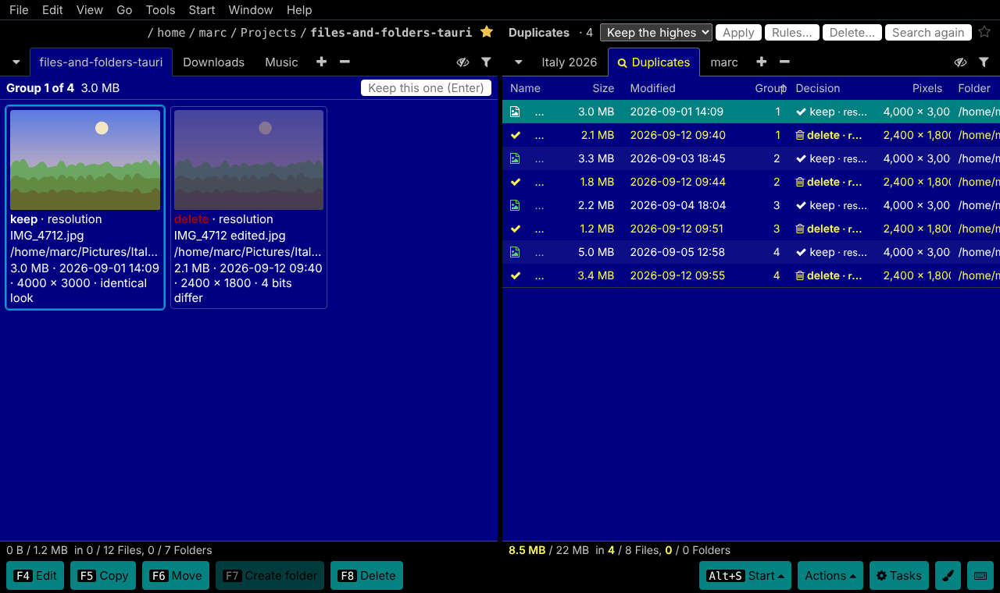

## Disk usage

**See at a glance what eats your disk.**
Scan the marked folders, the folder under the cursor or the whole drive. The list shows sizes with share bars,
the other panel draws rings or tiles. Go into folders with `Enter`, list the largest files, collect what can go
across all folders and remove it with `F8`.

`Ctrl+Shift+D` · macOS: `⌘⇧D`

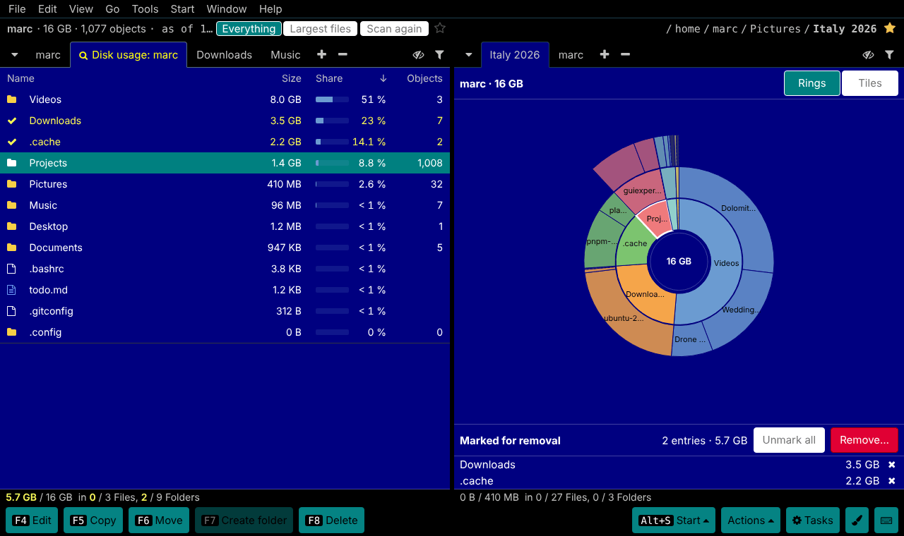

## Archives as folders

**Open ZIP, TAR, 7z and RAR like any other folder.**
Press `Enter` on an archive and browse it; view (`F3`) and open files inside, copy them out. Pack to ZIP, 7z, TAR
or TAR.GZ and unpack, with passwords (ZIP AES/ZipCrypto, 7z, RAR) that are only kept in memory. Archives from
elsewhere are treated as hostile: no zip-slip, no zip-bombs.

`Enter` open · `Alt+F5` pack · `Alt+F9` unpack · macOS: `Enter` · `⌥F5` · `⌥F9`

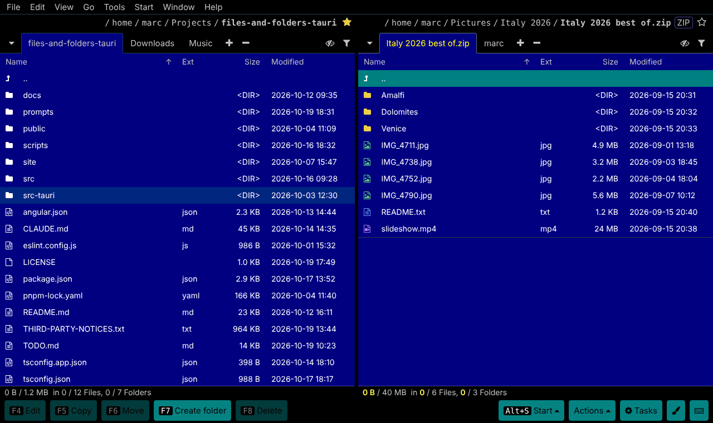

## FTP, FTPS and SFTP servers

**Your web space as a folder in the panel.**
Connect to FTP, FTPS and SFTP servers and work with them like with a local folder: tabs, history, copy and move
in both directions as jobs, delete, rename, view. Passwords and key passphrases are kept **only in your system
keychain** (macOS Keychain, Windows Credential Manager, Secret Service). SSH host keys and FTPS certificates are
checked; plain FTP is marked as unencrypted.

`Ctrl+K` · macOS: `⌘K`

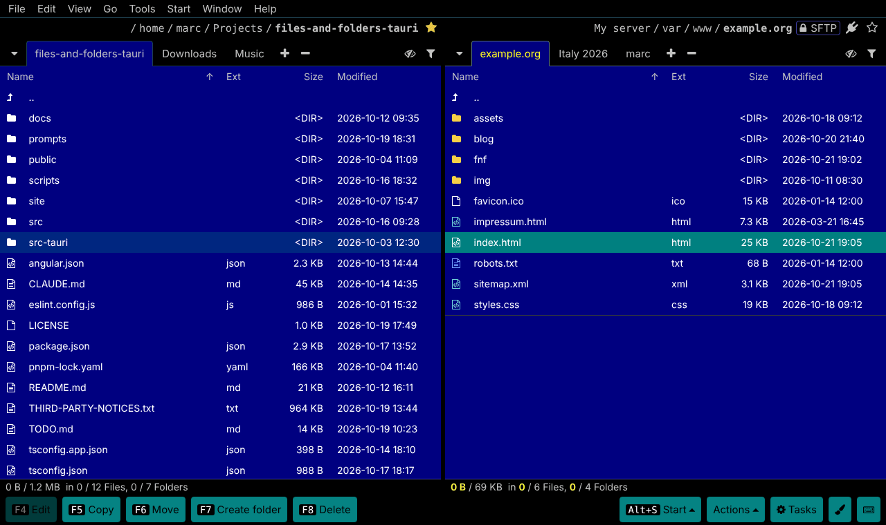

## Viewer and quick view

**Look into files without opening another program.**
`F3` shows text (with search and encoding detection), hex and images. The quick view shows the file under the
cursor in the other panel while you move through the list. *Properties* show times, permissions and owner.

`F3` view · `Ctrl+Q` quick view · `Alt+Enter` properties · macOS: `F3` · `⌃Q` · `⌘I`

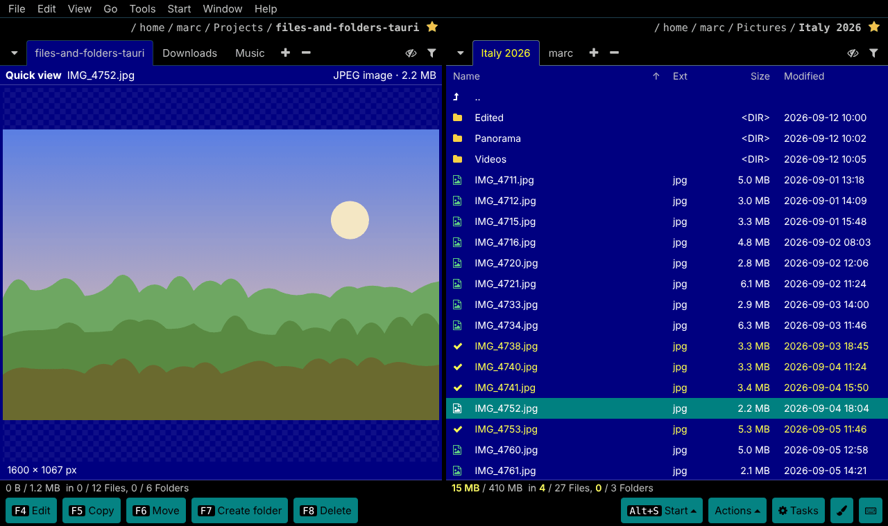

## Compare files

**Two files side by side, differences in colour.**
Line numbers, changed, added and removed lines; ignore white space or case; whole file or only the changes,
`F7` jumps to the next one. Binary files are compared byte by byte – or hand both files to FileMerge, WinMerge or
Meld.

Mark two files – in one panel, or one on each side – then *File ▸ Compare files…*

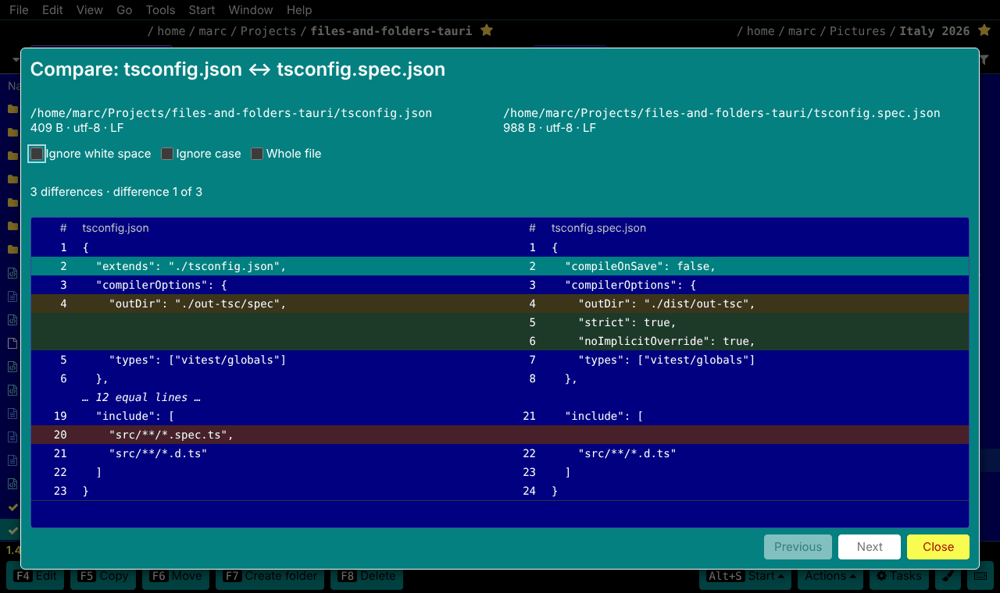

## Group files and clean folders

**Bring order into a messy folder in one step.**
*Group files* moves or copies files into folders built from their names (the name before a running number, the
first word, the text before a dash, the first letters) – with a preview. *Clean folders* removes empty folders and leftovers like `.DS_Store`, `Thumbs.db` or
`*.bak` (to the trash by default). *Create folders* makes many folders from a template.

`Alt+G` group · `Ctrl+Alt+R` clean · `Ctrl+F7` many folders · macOS: `⌥G` · `⌘⌥R` · `⌘F7`

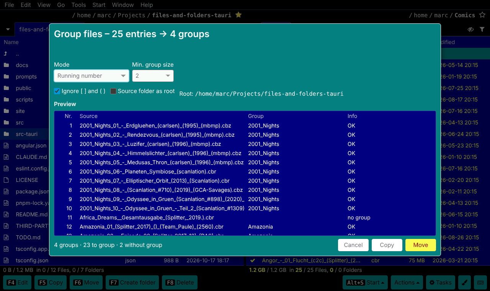

## Shell line

**A command line below the panels – in the folder you are looking at.**
Type a command, press `Enter`; the output streams in below, the history remembers your commands. `Ctrl+Shift+Enter`
inserts the marked names, quoted for your shell. For interactive programs, *Open terminal here* starts your real
terminal.

`Shift+F11` · macOS: `⇧F11`

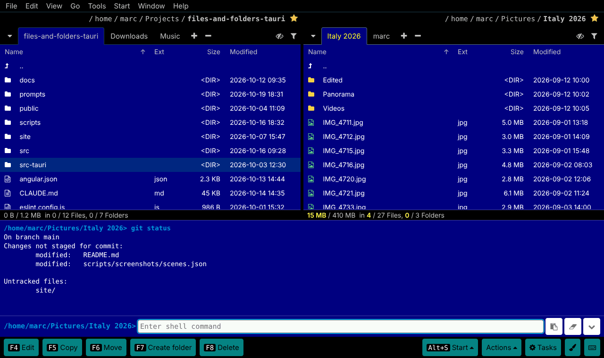

## Starter menu

**Your own launcher for programs, scripts and folders.**
Build a menu with submenus and give entries their own shortcuts. Parameters work like in Total Commander:
`%P%N` the file under the cursor, `%S` all marked files, `%T` the folder of the other side. Programs are started
directly – never through a shell.

`Alt+S` · macOS: `⌥S`

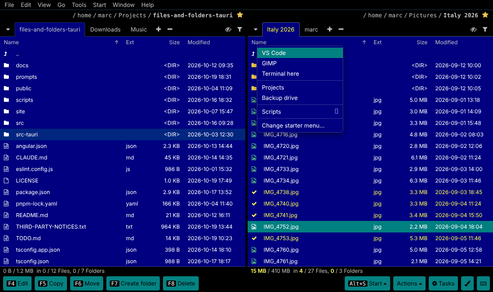

## Colour schemes

**Norton blue? Paper white? Dark? Your choice – or your own.**
Eleven built-in schemes: the eight classic designs of the earlier versions (Light, Paper, Bitbucket, Cypress,
Blackboard, Coffee, Combat, Norton) plus modern light, dark and Crimson. *Follow the system* switches between a
light and a dark one. The live editor checks every colour pair for WCAG contrast; schemes can be exported and
imported.

*Tools ▸ Colour schemes…* · `Ctrl+Alt+Shift+T` next scheme · macOS: `⌘⌃⌥T`

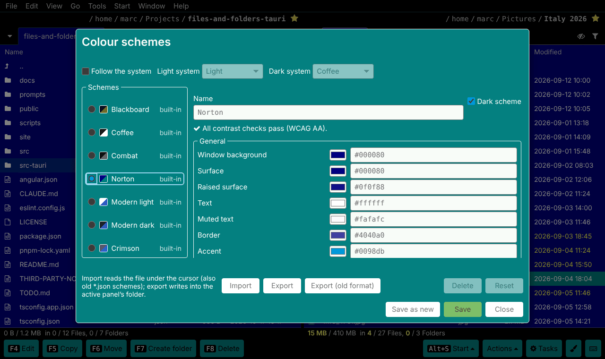

All eleven schemes:


## And more

Small things that save time every day:

- **Quick filter per tab** – type `*.jpg -thumb` and the list shows only what matches (`Ctrl+Alt+F` · `⌘⌥F`);
  hidden files on and off (`Ctrl+H` · `⌘⇧.`)
- **Folder sizes** – `Space` on a folder marks it and calculates its size, `Alt+Shift+Enter` does it for all
  marked folders (cancellable, symbolic links are not followed)
- **Folder menu ▾** – drives with file system and free space, servers, favourites (`Ctrl+D` · `⌘D`) and recently
  visited folders in one menu (`Alt+F1` / `Alt+F2`)
- **History per tab** – back and forward with cursor and scroll position (`Alt+←` / `Alt+→` · `⌘[` / `⌘]`, also
  mouse buttons 4/5)
- **Mark by pattern** – *Enhance / Reduce Selection* with wildcards or regex and one-click presets per file type
  (images, movies, documents …; `Num+` / `Num−`)
- **Clipboard** – names or full paths of the marked entries, also as JSON (`Ctrl+Alt+N` / `Ctrl+Alt+C` ·
  `⌘⌥N` / `⌘⌥C`)
- **Context menu** that fits the selection (`Shift+F10`), a menu bar with every action – native on macOS
- **New files and nested folders** – `Shift+F4` creates a file, `F7` takes `a/b/c`, and after `S01`, `S02` it
  suggests `S03`
- **Private** – no account, no telemetry, nothing phones home; server passwords live in your system keychain,
  archive passwords only in memory
- **Built with accessibility in mind** – every dialog, menu and list works with the keyboard alone; ARIA roles and
  announcements are in place, but the app has not been tested with a screen reader yet

And the bigger helpers:

- **Change attributes** – permissions (octal or per bit), Windows attributes, macOS *hidden*, times; for many
  entries at once and optionally for folder contents (`Ctrl+Shift+F2` · `⌘⇧F2`)
- **Checksums** – create and verify SHA-256/SHA-512/SHA-1/MD5 lists (`sha256sum`-compatible)
- **Drag & drop** between panels, from and to Finder/Explorer/your file manager; with `Ctrl+Shift` (`⌘⌥`)
  symbolic links
- **Auto refresh** – changes by other programs appear in under a second
- **External tools** and *Open terminal here* / *Show in Finder/Explorer* – started without a shell
- **Configurable** button bar, file types, shortcuts per OS; settings dialog with search, export and import
- **Import from the previous version** (*files-and-folders-mr*): shortcuts, buttons, colour schemes, tools …
- **English and German**, switchable at runtime
- Responsive with **slow and network drives** (listing cache, nothing blocks the window)

The complete list with all details (in German) is in [docs/features.md](docs/features.md).

## Installation

There is **no published release yet.** Until then, build the app yourself (see [Development](#development)).
Releases will appear on the [GitHub releases page](https://github.com/krocon/files-and-folders-tauri/releases):

| OS | Minimum | Package |
| --- | --- | --- |
| macOS | 12 Monterey (Apple Silicon and Intel) | `.dmg` (universal) |
| Windows | 10 / 11 (x64) | `-setup.exe` (no admin needed) or `.msi` |
| Linux | WebKitGTK 4.1 – Ubuntu 22.04+, Debian 12+, Fedora 36+ | `.deb`, `.rpm`, `.AppImage` |

The first packages will be **unsigned**: on macOS right-click the app → *Open*; on Windows SmartScreen choose
*More info* → *Run anyway*.

## Keyboard shortcuts (selection)

All shortcuts can be changed in **Keyboard shortcuts…** (`Ctrl+Shift+K` / `⌘⇧K`); the command palette
(`Ctrl+Shift+P` / `⌘⇧P`) lists every action.

| Action | Windows / Linux | macOS |
| --- | --- | --- |
| View | `F3` | `F3` |
| Edit (tool `edit`) | `F4` | `F4` |
| Copy / Move | `F5` / `F6` | `F5` / `F6` |
| Create folder | `F7` | `F7` |
| Delete (trash) / delete permanently | `F8` / `Shift+F8` | `F8`, `⌘⌫` / `⌘⌥⌫` |
| Rename in list / dialog | `F2` / `Shift+F6` | `F2` / `⇧F6` |
| Multi rename | `Ctrl+M` | `⌘F6` |
| Command palette – actions, folders and files | `Ctrl+Shift+P` | `⌘⇧P` |
| Find | `Alt+F7` | `⌥F7` |
| Find folder (change dir) | `Alt+F10` | `⌥F10` |
| Flat view (all files below) | `Ctrl+B` | `⌘B` |
| Mark / unmark | `Space`, `Insert` | `Space` |
| Switch panel | `Tab` | `Tab` |
| New tab / close tab | `Ctrl+T` / `Ctrl+W` | `⌘⌥T` / `⌘⌥W` |
| Swap panels (with all tabs) | `Ctrl+U` (`Ctrl+Shift+U`) | `⌘U` (`⌘⇧U`) |
| Target = source / open in other panel | `Ctrl+Alt+O` / `Ctrl+←`, `Ctrl+→` | `⌘⌥O` / `⌘⌥←`, `⌘⌥→` |
| Move tab left / right | `Ctrl+Shift+PgUp` / `Ctrl+Shift+PgDn` | `⌃⇧PgUp` / `⌃⇧PgDn` |
| Create link | `Ctrl+Shift+F5` | `⌘⇧F5` |
| Go to path | `Ctrl+L` | `⌘L` |
| Toggle hidden files | `Ctrl+H` | `⌘⇧.` |
| Quick view | `Ctrl+Q` | `⌃Q` |
| Pack / unpack | `Alt+F5` / `Alt+F9` | `⌥F5` / `⌥F9` |
| Find duplicates / next, previous group | `Alt+Shift+F7` / `Alt+↓`, `Alt+↑` | `⌥⇧F7` / `⌥↓`, `⌥↑` |
| Properties / change attributes | `Alt+Enter` / `Ctrl+Shift+F2` | `⌘I` / `⌘⇧F2` |
| Open terminal here | `Ctrl+Shift+C` | `⌘⇧C` |
| Connect to server | `Ctrl+K`, `Ctrl+N` | `⌘K`, `⌘N` |
| Shell line | `Shift+F11` | `⇧F11` |
| Full screen | `F11` | `⌃⌘F` (menu *Window*) |
| Settings | `Ctrl+,` | `⌘,` |

The full table is in [docs/features.md](docs/features.md#tastenkürzel-stand-prompt-002).

## Customization

Everything is stored as JSON in the app's config folder and can be edited from within the app:

- **Colours** – *Colour schemes…* dialog with live preview; schemes can be exported as `<name>.theme.json` and
  imported again (the old `--fnf-*` format of the previous versions is understood as well).
- **Shortcuts** – per OS (`macos`, `windows`, `linux`), overrides in `keymap.json`. An action can have several
  shortcuts, chords like `⌃K F6` are possible.
- **External tools** – `tools.json`: `program` + `args` array with placeholders such as `{file}`, `{files}`,
  `{dir}`, `{targetDir}`; optional `shortcut`. Example:

  ```json
  { "id": "edit", "label": "Edit", "program": "code", "args": ["{files}"] }
  ```

- **Starter menu** – menu *Start*, the *Start ▴* button next to *Actions ▴* or `Alt+S`: your own quick launch entries (programs, scripts, folders,
  submenus), edited with *Change starter menu…* and kept in `starter.json`. Parameters as in Total Commander –
  `%P%N` file under the cursor, `%N` name, `%O`/`%E` name without/only the extension, `%P`/`%T` folder of the
  active/other side, `%S` all marked entries; every word is one argument, nothing runs through a shell. Each entry
  can have its own shortcut.
- **Buttons** – *Button configuration…* (menu *Tools*): per modifier set (none, `Shift`, `Ctrl`/`⌘`, `Alt`) the
  actions of the bottom bar; changed sets are kept in `buttons.json`.
- **File types** – *File types…*: categories with extensions, icon and colour; they drive the file icons and the
  presets of *Mark by pattern* (`filetypes.json`, the old `[{label, extensions}]` format is read as well).
- **Settings** – `settings.json` (sizes, date format, row height, trash, start folder, language, own search
  templates …); the whole configuration can be exported and imported as one file.
- **Coming from the previous version** – *Import from Files and Folders (old)…* (menu *Tools*, *Settings ▸
  Data*) reads the `assets` folder of *files-and-folders-mr* (the repository folder is enough), shows per area what
  would be imported, what conflicts and what cannot be transferred, and keeps a `.bak` of every file it changes.

## Development

Requirements: **Node.js** `^22.22.3` / `^24.15.0` / `>=26`, **pnpm** 10 (`corepack enable`), **Rust** stable ≥ 1.90
and the [Tauri prerequisites](https://v2.tauri.app/start/prerequisites/) for your OS
(macOS: Xcode command line tools; Windows: C++ build tools + WebView2; Linux: `libwebkit2gtk-4.1-dev` and friends).

```bash
git clone https://github.com/krocon/files-and-folders-tauri.git
cd files-and-folders-tauri
pnpm install
pnpm tauri dev        # Angular dev server (port 1420) + desktop window
```

| Task | Command |
| --- | --- |
| All checks (format, lint, tests, build, Rust) | `pnpm check` |
| Frontend tests (Vitest) | `pnpm test` |
| Rust tests / clippy | `pnpm rust:test` / `pnpm rust:lint` |
| Release build (packages per OS) | `pnpm tauri build` |
| Screenshots of every colour scheme × every dialog | `pnpm screenshots` ([docs/screenshots.md](docs/screenshots.md)) |
| The pictures of this README | `pnpm screenshots:readme` |

Architecture and rules: [docs/architecture.md](docs/architecture.md) and [CLAUDE.md](CLAUDE.md);
release process: [docs/release.md](docs/release.md); what is done and what comes next:
[docs/roadmap.md](docs/roadmap.md) and [docs/feature-parity.md](docs/feature-parity.md).

### Tech stack

- **Tauri 2** – small native shell, narrow validated commands, strict CSP, no broad file-system or shell plugins
- **Rust** – listing, file operations, job engine, search, archives, watcher, platform code
- **Angular 22** – standalone components, signals, zoneless, plain CSS with design tokens
- **[GuiExpert Table](https://github.com/guiexperttable/mono)** – the file list and all preview grids
- **Font Awesome 4.5** – icons

## History

FnF started in 2016 as my playground for web technologies: a file manager that ran in the browser, with a
Node.js server doing the file work. In 2025 I rebuilt it with NestJS and Angular, and in 2026 it became a real
desktop app – one small native program, no local web server, no browser tab.

| Year | Project | Stack |
| --- | --- | --- |
| 2016 | [`files-and-folders`](https://www.npmjs.com/package/files-and-folders) | Node.js, Socket.IO, AngularJS – runs in the browser |
| 2025 | [files-and-folders-mr](https://github.com/krocon/files-and-folders-mr) | NestJS, Angular 20 – runs in the browser |
| 2026 | **files-and-folders-tauri** (this repo) | Tauri 2, Rust, Angular 22 – native desktop app |

## Contributing

Issues and ideas are welcome on [GitHub](https://github.com/krocon/files-and-folders-tauri/issues). Since the app
is still moving fast, please open an issue before starting a larger pull request.

## License

[MIT](LICENSE) © Marc Kronberg

Third-party licenses: [THIRD-PARTY-NOTICES.txt](THIRD-PARTY-NOTICES.txt) (full texts, shipped with the app), overview in [docs/licenses.md](docs/licenses.md).
